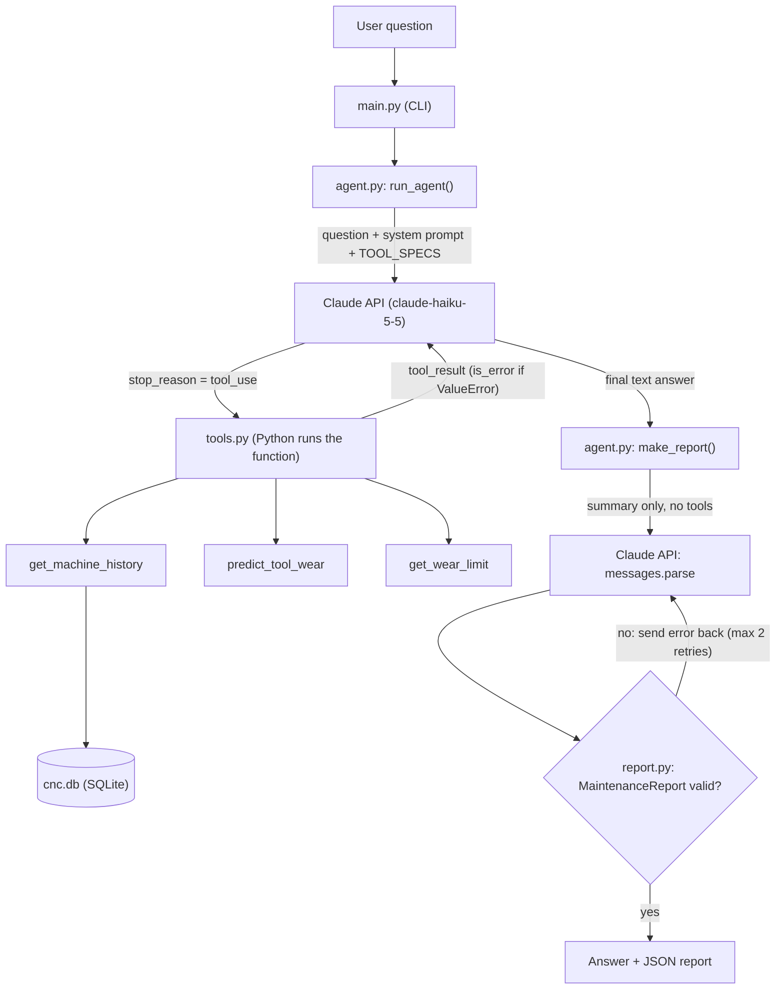

# CNC Assistant (v0)

An LLM agent that answers maintenance questions about CNC machines.
It reads machining history from a SQLite database, predicts tool wear with a physics-style formula,
compares the result with the wear limit for that tool type, and returns a **validated, structured maintenance report**.

Built in Week 1 of a 10-week roadmap from mechanical engineering (MSc research on CNC tool wear, PINN-Archard models) to LLM engineering.

## Example

> **Question:** Is the end mill on CNC-03 close to its wear limit?

The agent calls 3 tools in order, then answers:

| Step | Tool | Result |
| --- | --- | --- |
| 1 | `get_machine_history("CNC-03")` | end mill, 3 runs, 350 min total, avg. cutting force 821.7 N |
| 2 | `predict_tool_wear(821.7, 350)` | 258.8 µm |
| 3 | `get_wear_limit("end mill")` | 300 µm |

Report: wear 258.8 µm / 300 µm → `risk_level = "medium"`, with actions the user asked for kept separate from actions the model suggests.
Cost: about 4,500 input / 1,100 output tokens, roughly **$0.001 per question**.

## How it works



## Design choices

- **The LLM decides, Python computes.** The model only chooses which tool to call and with which arguments. All numbers come from tools; the system prompt forbids the model from doing its own wear calculations.
- **Errors go back to the model.** A tool raises `ValueError` with the exact bad value (e.g. `"Cutting force must be > 0 N, got -50 N"`). The agent returns it as a `tool_result` with `is_error=True`, so the model asks the user instead of inventing numbers (tested with unknown machine `CNC-99`).
- **Two separate calls.** Call 1 is the tool-using agent. Call 2 fills the report with `messages.parse` from a short summary (question + tool results + answer) without the tool list, which is cheaper and keeps "agent" and "form filling" apart.
- **Schema enforces structure, not logic.** Pydantic checks types; a `model_validator` adds a domain rule: if predicted wear ≥ the limit **for that tool type** (e.g. drill 250 µm, end mill 300 µm), `risk_level` must be `"high"`. If the rule fails, the error is sent back to the model to fix (max 2 retries).
- **Parameterized SQL** (`WHERE machine_id = ?`) to avoid SQL injection.

## Project files

| File | Role |
| --- | --- |
| `common.py` | Loads `.env`, creates the Anthropic client, sets `MODEL` |
| `db.py` | Creates `cnc.db` with a `runs` table (4 sample rows: CNC-03 end mill × 3 runs, CNC-05 drill × 1 run) |
| `tools.py` | The 3 tools, `TOOL_SPECS` (what the model sees) and `TOOLS` (name → Python function) |
| `report.py` | `MaintenanceReport` Pydantic model + validator |
| `agent.py` | `run_agent` (tool loop, tool log, token count) → `make_report` → `ask(question)` |
| `main.py` | Command-line interface: prints the answer and the JSON report |
| `eval.py` | Runs the test set and prints pass rate and cost |

## Setup and run

```bash
pip install -U anthropic python-dotenv pydantic
```

Create a `.env` file (never commit it):

```
ANTHROPIC_API_KEY=your_key_here
```

Then:

```bash
python db.py     # create cnc.db with sample data
python main.py   # ask a question
python eval.py   # run the evaluation
```

## Evaluation

10 questions × 3 runs each (outputs vary between runs, so one run is not enough).

| Metric | Result |
| --- | --- |
| Pass rate | **30 / 30 (100%)** |
| Tokens | 100,458 input / 26,981 output |
| Total cost | about $0.0235 (about $0.0008 per question) |

A run passes if:
1. the **set** of tools called matches the expected set (order not checked; some cases accept several valid behaviours, e.g. for a force of −50 N either calling `predict_tool_wear` and getting an error, or calling no tool);
2. a valid report was produced;
3. the predicted wear in the report is correct.

**Read this number with care:** it is a small, easy test set that I wrote myself.
It does **not** grade the quality of the text answer or the `risk_level`, and the machine-comparison question (CNC-03 vs CNC-05) only checks which tools were called.
Harder cases and LLM-as-judge grading are planned (see below).

## Limitations

- Wear model is a placeholder: `wear = 0.0009 × force × time` (Archard-style, linear). To be replaced by a PINN-Archard model.
- `cnc.db` holds only 4 hand-made sample rows.
- `get_wear_limit` silently returns 300 µm for an unknown tool type instead of raising an error.
- The model may still do arithmetic in its free-text answer (in an early version it estimated "0.74 µm/min, about 55–60 min left" assuming linear wear). The system prompt forbids this and the report only uses tool outputs, but nothing guarantees it 100%.
- Results vary between runs.

## Next steps

- **RAG:** retrieve from tool catalogues, machine manuals and maintenance logs so answers can cite sources (wear limits from real documents instead of a hard-coded table).
- Replace the linear wear formula with my PINN-Archard model.
- Stronger evaluation: harder and adversarial questions, grading of `risk_level` and answer quality with LLM-as-judge.
- Later: agent workflow with LangGraph, FastAPI service, PostgreSQL/pgvector, Docker, tracing.
